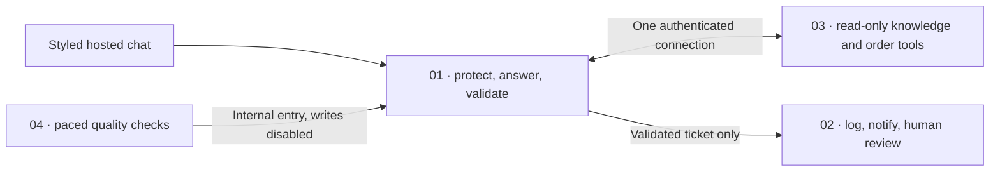

# Deploy Kaapi & Co.

A styled support product with coffee guidance, order lookup, policy sources, ticket tracking and human review. Everything runs in n8n Cloud. The interface and animations are included in the support workflow; there is no separate website to host.

**[Download and extract the starter ZIP](https://github.com/becomefde/fde-support-agent/releases/download/v5.0.0/Kaapi-Day3-Starter.zip).** Import these as separate workflows. Keep your Day 2 work.

| Import | Choose in n8n | Finish |
| --- | --- | --- |
| **02 Operations** | Your Google Sheets credential, the same new ticket-log Sheet/tab in all three Sheets nodes, and your Slack support channel in both Slack nodes. Import the supplied CSV headers into the new tab; keep Auto-Map. | Publish. |
| **03 MCP Server** | One Bearer Auth credential on **MCP SERVER**. Create the token yourself and keep it private. | Publish and copy its **Production URL**. |
| **01 Support — Gemini** | Your Gemini credential; in **MCP**, paste the copied URL and select the **same Bearer credential**; in **Save ticket**, select your 02 Operations. | Publish and copy **LIVE CHAT → Chat URL**. Open it outside the editor. |
| **04 Evals** | Your 01 Support in **Run 01 support** and your Gemini credential on the Judge. | Execute; open **Evaluation report → JSON** and copy the actual results. |

That is the whole MCP connection: **one server, one production URL, one shared credential**. The three read-only tools are discovered automatically. No separate server installation, vector database, per-tool URL or tool-field mapping is needed.

On 01, 02 and 03, check **Settings → save failed production / successful production / manual executions → Do not save**. The imported templates include these defaults; verify the actual controls in your instance. Waiting approvals still persist their masked state. Use fictional data only.

## Prove the product works

1. **Policy:** `Can I return an opened bag of coffee?` Expect the arrival-damage condition, 48 hours, photo and a policy source. No ticket.
2. **Real write:** `Where is my order KC1051? Please raise a support ticket.` Match the ticket ID in chat, Sheet and Slack.
3. **Replay:** repeat that exact message in the same chat. Expect the same ticket ID and one Sheet append / Slack post.
4. **Human review:** `I want a refund for order KC1063. It arrived damaged. Please raise a ticket.` Respond in Slack. Verify a later decision event for the same ticket. No money moves.
5. **Guardrails:** try an off-topic request, an instruction override and the fictional masking example in the [full test steps](ATTENDEE-STEPS.md#6-demonstrate-guardrails-and-real-approval).
6. **Evaluation:** run all 15 fixed cases. The runner pauses 20 seconds between cases to ease free-tier limits. Avoid sending chat messages during the run; allow about 8–12 minutes, longer if the provider is busy. Keep failures and inspect their reasons. This run creates no tickets or Slack notices.

**Your public chat is a fictional-data demo.** Anyone with its URL can consume workflow/model credits. MCP remains authenticated. Close the demo when no longer needed; real customer use requires the controls in [Production boundaries](PRODUCTION-BOUNDARIES.md).

## What each workflow does

Use **Gemini** for the complete build. Claude is an alternative to 01. Jev is an optional separate confidence exercise; it is not a deployment prerequisite. [Detailed setup and troubleshooting](ATTENDEE-STEPS.md) · [Build your portfolio evidence](PORTFOLIO.md).
