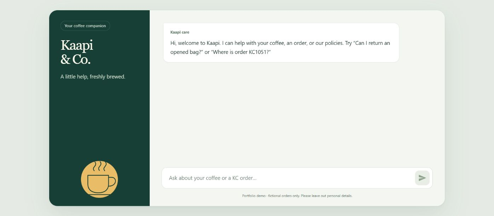

# Kaapi support

**[Download everything in one ZIP](https://github.com/becomefde/fde-support-agent/releases/download/v5.1.1/Kaapi-Day3-Starter.zip)**, or download the files individually:

| File | Purpose |
| --- | --- |
| **[Download 01 Support JSON](https://github.com/becomefde/fde-support-agent/releases/download/v5.1.1/01-Kaapi-Support.json)** | Branded chat, input masking, grounded answers, response validation and ticket requests. |
| **[Download 02 Backend JSON](https://github.com/becomefde/fde-support-agent/releases/download/v5.1.1/02-Kaapi-Backend.json)** | MCP tools, Google Sheets ticket log, Slack human review and the manual 15-case evaluation. |
| **[Download the blank ticket-log CSV](https://github.com/becomefde/fde-support-agent/releases/download/v5.1.1/Kaapi-Day3-Ticket-Log.csv)** | Import this into a new Google Sheet. It has the required headers and no sample customer rows. |

## Set up

**Publish order: 02 Backend → 01 Support → connect evals and republish 02.** The starter leaves the eval entry/call off to avoid a circular first-publish dependency.

1. **Create the log.** Download the CSV above. Open a [new Google Sheet](https://sheets.new), choose **File → Import → Upload**, select the downloaded CSV, and choose **Replace spreadsheet** in this NEW blank spreadsheet. Name it **Kaapi Ticket Log**. Keep the imported headers exactly as supplied.
2. **Import both workflows.** In n8n, create a workflow and choose **⋯ → Import from file** for `02-Kaapi-Backend.json`. Create another workflow and import `01-Kaapi-Support.json`. You should now have exactly two new workflows.
3. **Publish 02 Backend FIRST.** On all **three Google Sheets nodes**, select your credential, the new **Kaapi Ticket Log** and the **same imported tab**. On **Append ticket** and **Append decision**, set **Mapping Column Mode → Map Automatically LAST**. Select your credential/channel in both Slack nodes. On **MCP SERVER**, create/select one private **Bearer Auth** credential. Select Gemini on **Judge Gemini**. **Leave the two gray nodes — RUN EVALUATION and Run 01 support — deactivated. Do not select 01 yet.** Publish 02 and copy the MCP **Production URL**.
4. **Configure 01 Support.** On its Gemini node, select your Gemini credential. In **MCP**, paste the copied production URL and select the **same Bearer credential** used by 02. In **Save ticket**, select your 02 Backend workflow. **Publish 01**, then open **LIVE CHAT → Chat URL**. This is the deployed product link; the styling and animations are already included.
5. **Connect evals LAST.** After 01 is published, return to 02 Backend. On **Run 01 support**, select your published **01 Support**. Activate that node and **RUN EVALUATION** (right-click each gray node → **Activate**). **Republish 02 Backend.** Evals are now ready; the chat was already deployed in step 4.

Use your own credentials and destinations. Keep successful/failed production execution saving off. Backend manual execution saving can remain on to retain fictional evaluation reports.

## Check it

- Ask `Can I return an opened bag of coffee?` Expect the arrival-damage condition, 48 hours, photo and source. No ticket.
- Ask `Where is my order KC1051? Please raise a support ticket.` Match the ID in chat, Sheet and Slack. Repeat the exact message in the same session; expect the same ticket and no duplicate append or notice.
- Ask `I want a refund for order KC1063. It arrived damaged. Please raise a ticket.` Respond in Slack and check the later decision event. This records a review; it transfers no money.
- In **02 Backend**, execute **RUN EVALUATION**. The 15 fixed cases run with writes disabled and a 20-second pause between cases. Avoid using chat during the run; allow about 10 minutes. Open **Evaluation report → JSON** to inspect actual answers and reasons.

This is a public fictional-data demo. Anyone with the chat link can consume API/workflow credits. Real customer use additionally needs identity and order-ownership checks, request limits, monitoring and atomic database idempotency.
