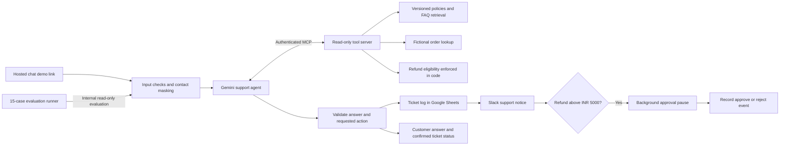

# Day 3: deploy and validate your Kaapi support assistant

Go from the Day 1 automation and Day 2 RAG/tools to a cloud deployment with evaluations, guarded actions and human review.

**Start here: [follow the attendee steps](ATTENDEE-STEPS.md).** Use Gemini for the complete project. Claude is optional. Jev is an optional confidence exercise and is not required to deploy.

## Download

These links download release attachments rather than opening GitHub's JSON viewer.

| File | Direct download |
| --- | --- |
| Everything for Day 3 | [Kaapi-Day3-Starter.zip](https://github.com/becomefde/fde-support-agent/releases/download/v5.0.0/Kaapi-Day3-Starter.zip) |
| 01 Support assistant, Gemini | [Download JSON](https://github.com/becomefde/fde-support-agent/releases/download/v5.0.0/kaapi-day3-01-support-gemini.json) |
| 01 Support assistant, Claude, optional alternative | [Download JSON](https://github.com/becomefde/fde-support-agent/releases/download/v5.0.0/kaapi-day3-01-support-claude.json) |
| 02 Ticket log and Slack human approval | [Download JSON](https://github.com/becomefde/fde-support-agent/releases/download/v5.0.0/kaapi-day3-02-operations.json) |
| 03 Read-only MCP server | [Download JSON](https://github.com/becomefde/fde-support-agent/releases/download/v5.0.0/kaapi-day3-03-mcp-server.json) |
| 04 Evaluation runner, Gemini judge | [Download JSON](https://github.com/becomefde/fde-support-agent/releases/download/v5.0.0/kaapi-day3-04-evals.json) |
| 05 Jev confidence gate, optional | [Download JSON](https://github.com/becomefde/fde-support-agent/releases/download/v5.0.0/kaapi-day3-05-optional-jev.json) |
| New ticket log headers for Google Sheets | [Download CSV](https://github.com/becomefde/fde-support-agent/releases/download/v5.0.0/Kaapi-Day3-Ticket-Log.csv) |

Import order: **02 operations → 03 MCP → 01 Gemini → 04 evals**. They are separate workflows with clear responsibilities. Do not replace your working Day 2 workflows.

## What you deploy

The write path belongs to the workflow, outside the model's tool loop. A model cannot approve a refund or claim a ticket was saved on its own. Slack notification and Sheet save are reported separately.

The same knowledge from Day 2 is bundled and versioned in the MCP server. This deployment uses keyword retrieval for the small fixed corpus, with the agent translating searches to English. It does not rely on a transient vector store or claim vector similarity. Day 2 remains available for the semantic RAG exercise.

## Session flow, 150 minutes

| Minutes | Build and verify |
| --- | --- |
| 0-10 | Show a finished request and explain the deployed project |
| 10-40 | Input/output guardrails, masking, deterministic refund controls and Slack approval |
| 40-65 | Run the fixed evaluation set; inspect actual failures and retrieved evidence |
| 65-90 | Publish the MCP tool server and connect the agent client |
| 90-100 | Optional Jev confidence/review exercise; keep Gemini-only attendees moving |
| 100-135 | Publish the hosted demo chat and test its live URL |
| 135-150 | Verify a ticket, approval and evidence for the portfolio |

For a practical build, import/configure 02 and 03 first; the teaching order can introduce their purpose before opening each section.

## Accounts and prerequisites

- Your active [n8n Cloud](https://n8n.io/) instance and existing Google/Slack connections.
- Your [Gemini API key](https://aistudio.google.com/api-keys), available model and quota. A free tier is subject to account/model limits.
- Your own [Google Sheet](https://sheets.google.com/) and Slack support channel.
- A new private Bearer Auth secret for your MCP connection and a public fictional-data hosted chat link. No secrets go into GitHub.
- Optional [Anthropic API access](https://platform.claude.com/settings/keys) for the Claude version.
- Optional TypeSafe AI node plus Gateway credits or your own TypeSafe key. Check availability and balance in your own account. Gemini is sufficient for the core project.

No local model, terminal install, frontend hosting account or paid Claude chat subscription is required for the Gemini path. A trial expiry or exhausted API balance can stop a deployed project.

## Completion criteria

You can call your workshop project deployed when:

1. Its hosted chat URL works outside the n8n editor and opens without a password.
2. A policy answer cites evidence and does not invent a ticket.
3. An actionable fictional order request produces the same ticket ID in chat, Sheet and Slack.
4. Repeating the same request in the same session skips a second append.
5. KC1063 pauses for a real Slack decision, then records a separate decision event.
6. Off-topic, instruction-override, missing-order and masking examples behave as documented.
7. Your saved evaluation report contains actual answers, scores, reasons and failed evidence, with no ticket/Slack writes.

Record your own measured outcomes. See [attendee steps](ATTENDEE-STEPS.md) for tests and [production boundaries](PRODUCTION-BOUNDARIES.md) for the next steps before using real customer data. The project demonstrates production-oriented design; it does not establish a load-tested, customer-ready service.

## References

- [n8n hosted Chat Trigger and authentication](https://docs.n8n.io/integrations/builtin/core-nodes/n8n-nodes-langchain.chattrigger/)
- [MCP Server Trigger](https://docs.n8n.io/integrations/builtin/core-nodes/n8n-nodes-langchain.mcptrigger/)
- [MCP Client Tool](https://docs.n8n.io/integrations/builtin/cluster-nodes/sub-nodes/n8n-nodes-langchain.toolmcp/)
- [Slack node and Send and Wait](https://docs.n8n.io/integrations/builtin/app-nodes/n8n-nodes-base.slack/)
- [TypeSafe/Jev n8n Cloud announcement; its October 10 free promotion has ended](https://community.n8n.io/t/typesafes-jev-is-now-in-n8n-free-on-cloud-via-gateway-credits-until-october-10/317957)
